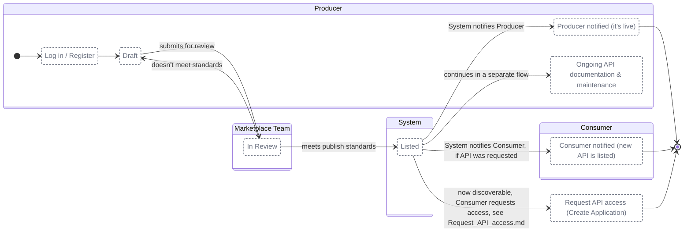

# Publish API

**MVP status** (end-of-October MVP; basis: a read of the web-api-marketplace and service-api-marketplace repositories on 27 Oct 2026 and the Release column in the Jira story spreadsheets, not a test of a deployed environment). The flow itself is the target design and is unchanged; only the shading is new.

| Shading | Meaning |
|---|---|
| Green | Built: working in the product |
| Amber | Partial: the core behaviour exists, some of it does not |
| Blue | Offline: happens, but by hand outside the product |
| White, dashed grey outline | Phase 2: not built. Which Phase 2 items get delivered is for the team to decide, so these will change |

At MVP there is no Publish API flow. Producers add a GitHub docs workflow and email the Marketplace team.
