# Request API access

```mermaid
stateDiagram-v2
    direction LR

    state "Consumer" as ReqAccess_Consumer {
        [*] --> LoginGateAccess
        LoginGateAccess: Log in / Register
        CreateApplication: Create Application (for the Try it now environment)
        TestTryItNow: Test via Try it now
        RequestProd: Requests Prod access
        ProvidesInfoConsumer: Provides further information (about the data, to help DAP's review)
        NotifyDecisionConsumer: Notify of decision
    }

    state "DAP" as ReqAccess_DAP {
        NotifiedDAP: Notified
        InReviewAccess: In Review (checks terms & conditions, reviews who + why)
        ApprovedDeclinedAccess: Approved / Declined
        NotifyDecisionDAP: Notify of decision
    }

    state "Producer" as ReqAccess_Producer {
        NotifiedProducer: Notified
        ProvidesInfoProducer: Provides further information (about the data, to help DAP's review)
    }

    state "System" as ReqAccess_Sys {
        IssueTryItNowCreds: Issue Try it now credentials (automatic, no review needed)
        NotifyProdRequest: Notify of Prod request
    }

    state "API Marketplace Team" as ReqAccess_Team {
        NotifiedTeam: Notified
        NotifyDecisionTeam: Notify of decision
        IssueProdCreds: If approved, issue Prod credentials / keys
    }

    LoginGateAccess --> CreateApplication
    CreateApplication --> IssueTryItNowCreds: creates application
    IssueTryItNowCreds --> TestTryItNow: credentials ready
    TestTryItNow --> RequestProd
    RequestProd --> NotifyProdRequest: same application

    NotifyProdRequest --> NotifiedDAP
    NotifyProdRequest --> NotifiedProducer
    NotifyProdRequest --> NotifiedTeam

    NotifiedDAP --> InReviewAccess
    InReviewAccess --> ProvidesInfoConsumer: more info needed (Consumer)
    ProvidesInfoConsumer --> InReviewAccess: responds
    InReviewAccess --> ProvidesInfoProducer: more info needed (Producer)
    ProvidesInfoProducer --> InReviewAccess: responds
    InReviewAccess --> ApprovedDeclinedAccess

    ApprovedDeclinedAccess --> NotifyDecisionDAP
    NotifyDecisionDAP --> NotifyDecisionConsumer
    NotifyDecisionDAP --> NotifyDecisionTeam

    NotifyDecisionConsumer --> [*]
    NotifyDecisionTeam --> IssueProdCreds: if approved
    IssueProdCreds --> [*]

    %% ===== MVP status overlay (end-of-October MVP; basis: repo read 27 Oct 2026 + Jira story-sheet Release column) =====
    %% built = working in the product | partial = core exists | offline = by hand, outside the product | Phase 2 = not built
    classDef mvpBuilt fill:#E1EAE4,stroke:#3F6355,stroke-width:2px,color:#232733
    classDef mvpPartial fill:#F2E8D5,stroke:#8C6A22,stroke-width:2px,color:#232733
    classDef mvpOffline fill:#E3E8F0,stroke:#233A5E,stroke-width:2px,color:#232733
    classDef mvpPhase2 fill:#FFFFFF,stroke:#6B7180,stroke-width:1.5px,stroke-dasharray:4 3,color:#6B7180

    class LoginGateAccess,CreateApplication,IssueTryItNowCreds,TestTryItNow,RequestProd mvpBuilt
    class NotifyProdRequest,NotifiedDAP,NotifiedProducer,NotifiedTeam mvpPartial
    class InReviewAccess,ApprovedDeclinedAccess,IssueProdCreds mvpOffline
    class ProvidesInfoConsumer,ProvidesInfoProducer,NotifyDecisionConsumer,NotifyDecisionDAP,NotifyDecisionTeam mvpPhase2
```

**MVP status** (end-of-October MVP; basis: a read of the web-api-marketplace and service-api-marketplace repositories on 27 Oct 2026 and the Release column in the Jira story spreadsheets, not a test of a deployed environment). The flow itself is the target design and is unchanged; only the shading is new.

| Shading | Meaning |
|---|---|
| Green | Built: working in the product |
| Amber | Partial: the core behaviour exists, some of it does not |
| Blue | Offline: happens, but by hand outside the product |
| White, dashed grey outline | Phase 2: not built. Which Phase 2 items get delivered is for the team to decide, so these will change |

At MVP a Consumer can create one application and get Try it now credentials automatically, then submit one production request per application (a second is refused). On submit the requester and a configured reviewer list are emailed. DAP's review and decision, and creating the production credentials, happen offline by hand. Nothing in the product yet asks for more information, notifies anyone of the decision, or moves an API to Active.
